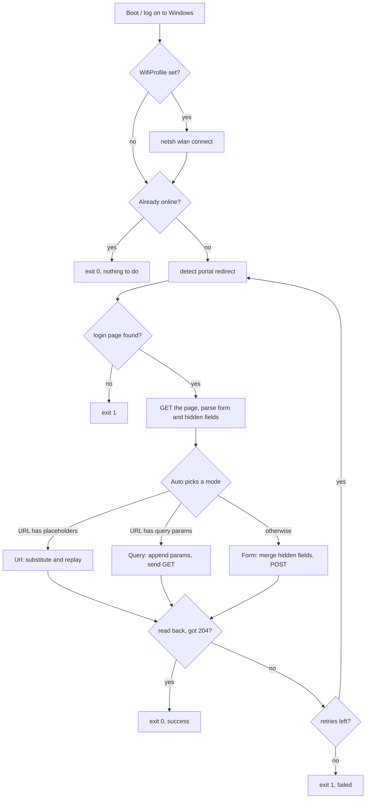

<div align="center">

# Campus Net Autoconnect

Completes your campus network's web portal login automatically after you log into Windows.

Self-contained PowerShell · zero dependencies · password encrypted with Windows DPAPI

[](https://github.com/sixrg7734/ccsu-campus-network-login/actions/workflows/test.yml)
[](#compatibility)
[](#compatibility)
[](LICENSE)

English · [简体中文](README.md)

</div>

---

## Overview

Most university campus networks use web portal authentication: you join the Wi-Fi, the browser opens a login page, you enter your student ID and password, and only then do you get internet access. This repeats on every boot.

This project automates that step. It fills in and submits the login form, then reads back to confirm the network is actually up, retrying as configured if it is not. The script makes no assumptions about the portal's structure: it detects the portal redirect at runtime and parses the real field names and hidden parameters (such as `wlanuserip`, `wlanacname`, `nasip`) out of the login page HTML. Adapting it to another school usually means editing the config only.

## Scope

Only web portal authentication is handled, including standard portals (Huawei, H3C and similar), Srun (深澜), and Dr.COM / 城市热点. The following are not supported:

- Client application authentication, as used by Srun, Dr.COM, Ruijie or NetKeeper client modes.
- PPPoE.
- Portals with a CAPTCHA.
- Portals that encrypt the password in browser-side JavaScript (RSA or a custom scheme). There the password is computed by the page and cannot be replayed.

## Accounts and privacy

The script uses your own account and password to log into your own account. It contains no logic for bypassing authentication, spoofing an identity, or guessing credentials.

It sends no telemetry and contacts no third-party servers. Apart from your school's portal and the connectivity-check URL in your config, it makes no other requests.

---

## Features

| Item | Description |
|---|---|
| Zero dependencies | Uses only the PowerShell that ships with Windows. No Python, no Node, no third-party libraries |
| Discovers the portal | Detects the portal redirect at runtime and parses the real field names and hidden parameters from the login page HTML |
| Several submit modes | `Query` (parameters in the URL, GET), `Form` (parse the form, then POST) and `Url` (replay a captured request). `Auto` picks one |
| Encrypted password at rest | Windows DPAPI (`CurrentUser` scope). The ciphertext only decrypts for the same Windows user on the same machine |
| Read-back verification | After logging in it probes the connectivity-check URL (`generate_204` by default), retries as configured, and returns exit code 1 if the network is still down |
| Redacted logs | The password is replaced with `***` before anything is written to the log, so a portal that echoes it back is not recorded |
| Optional keep-alive | The installer can add a trigger that checks every 10 minutes and reconnects after a drop |
| Tests included | The repo ships a mock portal gateway and drives the real script against it: 40 assertions |

---

## Quick start

```powershell
git clone https://github.com/sixrg7734/ccsu-campus-network-login.git
cd ccsu-campus-network-login

# wizard: detect the portal -> enter credentials -> one test login -> install autostart
powershell -NoProfile -ExecutionPolicy Bypass -File .\Setup-CampusNet.ps1
```

You can also download just `Connect-CampusNet.ps1` and `Setup-CampusNet.ps1` into one folder; either way works.

The wizard asks for each setting in turn, and pressing Enter accepts the default. Once it finishes, you are authenticated roughly 20 seconds after you log into Windows. To try the script without installing autostart, answer `n` to the final question.

Windows 10 / 11 with the bundled Windows PowerShell 5.1 is enough. PowerShell 7 works as well.

> The first wizard step detects the portal. If you are already online there is no intercept redirect, so no field names can be read; the wizard tells you when that happens. For an accurate result, disconnect the Wi-Fi or unplug the cable and run it again.

### Everyday commands

```powershell
.\Connect-CampusNet.ps1              # one login attempt (exits immediately if already online)
.\Connect-CampusNet.ps1 -Force       # ignore the current state, force one login attempt
.\Connect-CampusNet.ps1 -Probe       # detect the portal, print field names, dump the page
.\Connect-CampusNet.ps1 -ProbeJson   # same, as JSON (used by the wizard)
.\Setup-CampusNet.ps1                # run the wizard again
.\Setup-CampusNet.ps1 -Test          # re-run one login attempt, change nothing
.\Setup-CampusNet.ps1 -Uninstall     # remove autostart
.\tests\Run-Tests.ps1                # run the full test suite (40 assertions)
```

Exit codes of `Connect-CampusNet.ps1`:

| Code | Meaning |
|---|---|
| `0` | Login succeeded, or the machine is already online and nothing was needed |
| `1` | Login failed |
| `2` | Config file not found; run `Setup-CampusNet.ps1` first |

`-Quiet` prints only what is necessary, `-NoLog` writes no log, and `-ConfigPath` points at a different config file.

---

## How it works



The script GETs the login page, extracts every `<input>`'s `name`, `value` and `type`, and fills in the fields you configured. Session parameters such as `wlanuserip`, `wlanacname` and `nasip` are read from the page at runtime and never hardcoded.

`Mode` selects the submit method. `Auto` decides in this order: `Url` when `LoginUrl` contains `{placeholders}`, `Query` when it contains a query string, otherwise `Form`. After submitting, the script probes the connectivity-check URL and retries if the check fails.

---

## Layout

```
.
├── Connect-CampusNet.ps1            main script (this is what autostart runs)
├── Setup-CampusNet.ps1              wizard, plus autostart install/uninstall
├── campus-net.config.example.json   example config
├── campus-net.config.ccsu.example.json  CCSU example config
├── tests/
│   ├── Mock-Portal.ps1              mock portal gateway (raw HTTP/1.1 over TcpListener)
│   └── Run-Tests.ps1                end-to-end tests against the mock portal
├── .github/workflows/test.yml       CI: parser lint + end-to-end tests
├── README.md / README.en.md
└── LICENSE
```

At runtime the script creates `campus-net.config.json` and `连网日志.txt` next to itself (the log rotates to `.old` past 512 KB). Both are gitignored.

---

## Configuration

The wizard fills most of this in. For hand-tuning, the config file is `campus-net.config.json`; the fields are listed in `campus-net.config.example.json`.

| Key | Default | Meaning |
|---|---|---|
| `LoginUrl` | — | Full URL of the portal login page. Empty means auto-detect on every run |
| `PortalUrl` | — | A manually supplied portal URL. Wins over auto-detection; rarely needed |
| `Mode` | `Auto` | `Auto` / `Url` / `Query` / `Form`. `Url` replays a captured request (supports placeholders); `Query` puts the parameters in the URL and sends a GET; `Form` parses the hidden fields and POSTs. The `Auto` order is described under "How it works" |
| `UserField` | `username` | `name` of the account input |
| `PwdField` | `password` | `name` of the password input |
| `PwdTransform` | `plain` | Transformation applied to the password before submitting: `plain` / `base64` / `md5` |
| `PwdTemplate` | `{pwd}` | Password template. Placeholders: `{pwd}` `{plain}` `{b64}` `{b64d}` (base64 twice) `{md5}` `{user}` `{token}` |
| `TokenRegex` | — | Regex that scrapes a token from the login page. Capture group 1 is the token, used by `{token}` |
| `ExtraFields` | — | Extra fixed parameters, e.g. `{"wlanacname":"xxx","nasip":"1.2.3.4"}`. Values may use `{localip}` (this machine's outbound IP, filled at runtime) and `{user}` |
| `Headers` | — | Extra request headers, e.g. `{"Referer":"http://..."}` |
| `User` | — | Account |
| `UserSuffix` | — | Suffix appended to the account. Dr.COM / 城市热点 uses it for the carrier, e.g. `@lt` (Unicom), `@dx` (Telecom) |
| `PwdEnc` | — | DPAPI ciphertext. Do not edit by hand |
| `PwdPlain` | — | Plaintext password. When empty, `PwdEnc` is used |
| `WifiProfile` | — | Name of the saved Wi-Fi profile to connect before logging in |
| `SuccessTestUrl` | `http://connect.rom.miui.com/generate_204` | Connectivity-check target |
| `SuccessStatus` | `204` | Expected status code |
| `SuccessRegex` | — | Expected response body regex. A match means online; if it does not match, the status code is still checked |
| `AllowInvalidCert` | `false` | Accept self-signed or expired certificates. Some portals require it; see "Security notes" for the cost |
| `RetryCount` | `6` | Number of retries |
| `RetryDelaySec` | `10` | Delay between retries, in seconds |
| `LogFile` | `<script dir>\连网日志.txt` | Log path |

### Replaying a captured request (`Mode = Url`)

Some portals (CCSU is one) build their login page entirely in JavaScript, so the HTML contains no `<form>` and `-Probe` cannot enumerate anything. Use `Url` mode: paste the real login request URL you captured from the browser, replace only the account, password and local-IP values with placeholders, and the script substitutes them on every run before sending the request.

```json
"Mode": "Url",
"LoginUrl": "http://10.0.100.3:801/eportal/portal/login?user_account={user}&user_password={pwd}&wlan_user_ip={localip}"
```

Available placeholders:

| Placeholder | Expands to | URL-encoded |
|---|---|---|
| `{user}` | the account (with `UserSuffix` already appended) | yes |
| `{userraw}` | same, not encoded | no |
| `{pwd}` | the password (after `PwdTransform` / `PwdTemplate`) | yes |
| `{plain}` | the plaintext password | yes |
| `{b64}` | base64 of the password | yes |
| `{md5}` | md5 of the password | no |
| `{localip}` | this machine's outbound IP (it changes with DHCP, hence the placeholder) | no |
| `{token}` | the token scraped by `TokenRegex` from the login page | yes |

Every other parameter is preserved verbatim, so you can paste the captured URL as-is and edit only those three values. Leaving `Mode` at `Auto` also works: when `LoginUrl` contains `{placeholders}`, `Auto` picks `Url`.

### Portal recipes

| Portal type | Typical settings |
|---|---|
| Huawei / H3C standard portal | `Mode = Query`. The redirect URL already carries `wlanuserip` / `wlanacname` / `nasip`; only the credentials need substituting |
| Srun (深澜) | Most versions need `PwdTransform = base64`. When the page carries a token, set `TokenRegex` and use `{token}` |
| Older Dr.COM | Commonly wants the password prefixed with `0`: `PwdTemplate = 0{pwd}` |
| Pure JS-rendered portals (no `<form>`) | Replay a captured request with `Mode = Url`, as described above |

### Changsha University (CCSU) reference

CCSU runs a Dr.COM / 城市热点 portal at `http://10.0.100.3/`, with the auth API on port 801. The values below come from the portal's own server-side config variables and from the university's network centre, not from guesswork:

| Item | Value | Source |
|---|---|---|
| Wi-Fi SSIDs | `CCSU-Teacher` (staff) / `CCSU-Student` (students) | [University network centre guide](http://nic.ccsu.cn/info/1441/9601.htm) |
| Portal | `http://10.0.100.3/` | same |
| Auth endpoint | `http://10.0.100.3:801/eportal/?c=ACSetting&a=Login` | in-page `authloginpath` |
| Account field | `DDDDD` | in-page `authuserfield` |
| Password field | `upass` | in-page `authpassfield` |
| Page charset | `gb2312` | in-page `charset` |
| Success marker | `Dr.COMWebLoginID_3.htm` | in-page `authsuccess` |

The "pick a carrier" step is not a dropdown but a radio group, and it works by appending a suffix to the account. The portal's own config reads:

```js
carrier='{"yys":{"title":"服务类型","mode":"radiobutton","type":"0","data":[
  {"id":"1","name":"校园用户","suffix":""},
  {"id":"2","name":"校园电信","suffix":"@dx"},
  {"id":"3","name":"校园联通","suffix":"@lt"},
  {"id":"4","name":"校园其他","suffix":""}],"defaultID":"1"}}';
```

Which maps to:

| What you pick | Account actually submitted | Config |
|---|---|---|
| 校园用户 (campus) | `2023000000` | `"UserSuffix": ""` |
| 校园电信 (Telecom) | `2023000000@dx` | `"UserSuffix": "@dx"` |
| 校园联通 (Unicom) | `2023000000@lt` | `"UserSuffix": "@lt"` |

This is supported natively since v1.1: `UserSuffix` is appended to the account, and a radio group submits the `checked` member. v1.0 submitted the last value in the group instead, a bug that was found and fixed while adapting this portal.

A ready-to-copy config is in [`campus-net.config.ccsu.example.json`](campus-net.config.ccsu.example.json); copy it to `campus-net.config.json`.

#### Capturing a real login request

This portal's login page is rendered entirely by JavaScript, with no `<form>` in the HTML, so `-Probe` cannot enumerate the fields. Only a real login request reveals the full parameter set. Capturing one takes about two minutes:

1. Open the browser's `F12` tools, switch to the Network panel, and enable Preserve log;
2. Log out of the campus network (or start from a logged-out state) and log in by hand once;
3. Find the login request, whose path usually contains `eportal`;
4. Right-click it and choose Copy as cURL, or read its Query String / Form Data directly.

Then fill in the config according to the request shape:

- GET (parameters in the URL): use `Mode = Url`, paste the whole URL into `LoginUrl`, and replace only the account, password and local IP with `{user}` / `{pwd}` / `{localip}`:

  ```json
  "Mode": "Url",
  "LoginUrl": "http://10.0.100.3:801/paste your captured URL here, with the account as {user}, the password as {pwd} and the IP as {localip}"
  ```

- POST (parameters in a form body): use `Mode = Form`, put the request target in `LoginUrl` and the remaining form fields in `ExtraFields` (use `{localip}` for `wlanuserip`).

`campus-net.config.ccsu.example.json` already contains a starting point in the GET shape. You only need to swap `LoginUrl` for the request you captured.

> The field names and the carrier mechanism are confirmed; the complete parameter set is not. The machine used to write this was already authenticated, so the logged-out login page could not be captured. The example config is a reasoned starting point derived from the portal's own config variables and its JavaScript, and has not been verified working.

---

## Troubleshooting

### No portal detected

In order of likelihood:

- You are already online, in which case there is no intercept redirect and this is the expected result;
- The Wi-Fi is not associated; set `WifiProfile`;
- Your school uses a client application rather than web authentication, which this project does not support.

### Portal detected, but the login still fails

- Check `UserField` / `PwdField` against the field list printed by `.\Connect-CampusNet.ps1 -Probe`, or the full HTML dumped to `门户探测结果.txt`;
- If the password needs transforming, try `PwdTransform` with `base64` or `md5`;
- If the page needs a token or extra parameters, configure `TokenRegex` or `ExtraFields`;
- The most effective move is to capture one real login request for comparison: press `F12`, open Network, log in by hand once, right-click that request and choose Copy as cURL, or read its URL and Form Data and copy the parameter names into the config.

### "Password decryption failed"

DPAPI ciphertext is bound to the current machine and the current Windows user. A new machine, a new account, a reinstall, or copying the config elsewhere all break it. Re-run `.\Setup-CampusNet.ps1` and enter the password once.

If you genuinely need to use it across machines, put plaintext in `PwdPlain`, at the cost of storing the password in the clear.

### Certificate errors, or the login request fails outright

Campus portals frequently use self-signed or expired certificates. Set `AllowInvalidCert` to `true` in the config, or answer `y` when re-running the wizard.

That disables certificate validation, which weakens your protection against man-in-the-middle attacks. Enable it only when the portal really does use a bad certificate, and do not leave it on while using public Wi-Fi.

### Running the scheduled task by hand

```powershell
Start-ScheduledTask -TaskName 'CampusNet-Autoconnect'
Get-ScheduledTaskInfo -TaskName 'CampusNet-Autoconnect' | Select LastRunTime, LastTaskResult
```

---

## Testing

This project does not treat "the script did not throw" as evidence of success. The repo ships a mock campus network gateway (`tests/Mock-Portal.ps1`) that behaves like the real thing: `302` to a login page when unauthenticated, `204` once authenticated.

`tests/Run-Tests.ps1` starts that gateway, runs the real main script, and then checks what the portal side actually received:

```powershell
.\tests\Run-Tests.ps1
```

Current result: 40/40 passing on Windows PowerShell 5.1.

| Scenario | Assertions |
|---|---|
| A `Form` mode | exit 0 · portal received `POST /login` · portal reports success · the page's hidden fields were carried along |
| B `Query` mode | exit 0 · portal received a GET carrying `username` · pre-existing query params were preserved · success |
| C wrong password | exit 1 · portal logged `LOGIN-FAIL` |
| D DPAPI ciphertext | exit 0 · the decrypted password round-trips correctly |
| E `-ProbeJson` contract | stdout is valid JSON · online state correct · portal URL detected · account and password fields guessed correctly · form action resolved · fields enumerated |
| F Dr.COM / 城市热点 shape | account submitted with the `@lt` suffix · password sent to `upass` · the radio group submits the `checked` member (neither the first nor the last) · `{localip}` expanded to a real IP · static `ExtraFields` passed through · portal accepted the login |
| G `-ProbeJson` on a Dr.COM page | account field guessed as `DDDDD` · password field guessed as `upass` · carrier field guessed as `yys` · radio group enumerated (3 options) · `<select>` parsed and bound to its `selected` option |
| H `Mode = Url` replay | exit 0 · `{user}` replaced with the `@lt`-suffixed account, correctly URL-encoded · `{pwd}` replaced · `{localip}` replaced with a real IP · literal params preserved verbatim · portal accepted the replay |

In scenarios F and G the checked radio in the mock page has value `2` while the options are ordered `1 / 2 / 3`, so both "keep the first option" and "keep the last option" fail. v1.0 did the latter, which would have logged a Unicom user in as a campus user.

Scenario E covers the interface between `Setup-CampusNet.ps1` and `Connect-CampusNet.ps1`, which is how the wizard obtains its detection results.

The suite is fully local: every URL points at `127.0.0.1`, so it needs no internet and is safe in CI. `.github/workflows/test.yml` runs a parser check and the end-to-end suite on every push, and runs the suite again under PowerShell 7.

---

## Security notes

- The password is encrypted with Windows DPAPI (`CurrentUser` scope). The ciphertext only decrypts for the current user on the current machine, and copying the config elsewhere does not help. The cost is that changing machine, changing user, or reinstalling Windows means re-running the wizard.
- Autostart therefore triggers at logon, not at boot: during boot the user's registry hive is not loaded and DPAPI cannot decrypt. The installer uses an `AtLogOn` trigger with a 20-second delay.
- The scripts do not write to the registry and do not change system settings. They only read and write their own directory.
- Passwords are replaced with `***` before being written to the log.
- `campus-net.config.json`, `连网日志.txt` and `门户探测结果.txt` are gitignored. Check `git status` before committing. The probe dump contains a full portal page and may include your IP and MAC address.
- Without elevation, autostart falls back to a shortcut in the Startup folder (a `.lnk`, UTF-16 encoded, so non-ASCII paths are fine). It works, but has no keep-alive trigger. Re-run the wizard as administrator if you want one.

---

## Known limitations

- Web portal authentication only. Client authentication (Srun, Dr.COM, Ruijie, NetKeeper client modes) and PPPoE are not supported.
- No CAPTCHA support.
- No support for portals that encrypt the password in browser-side JavaScript (RSA or a custom scheme). There the password is computed by the page and cannot be replayed. The workaround is to capture the full URL of a real login with `F12` and put it in `LoginUrl` with `Mode` set to `Url`.
- Windows only, since it relies on DPAPI and Task Scheduler.
- The script must hold the plaintext password to submit the form. That is inherent to HTTP form authentication; DPAPI protects data at rest, not runtime memory.

---

## Compatibility

| Item | Notes |
|---|---|
| OS | Windows 10 / 11 (Windows Server 2016 or newer should work; untested) |
| PowerShell | Windows PowerShell 5.1 (primary target) and PowerShell 7 (exercised in CI) |
| Privileges | Runs as a normal user. A keep-alive scheduled task needs administrator rights |

---

## Contributing

PRs are welcome. Before submitting:

1. Run `.\tests\Run-Tests.ps1` and confirm 40/40;
2. If you changed `Connect-CampusNet.ps1`, add a matching assertion to `Run-Tests.ps1` rather than relying on a visual check;
3. Make sure `.ps1` files are saved as **UTF-8 with BOM** and that all other files have no BOM.

Why item 3 matters: Windows PowerShell 5.1 decodes BOM-less UTF-8 using the system ANSI code page, which turns non-ASCII comments into mojibake and then into syntax errors. Conversely, adding a BOM to `.md` / `.json` / `.yml` is harmful, since a YAML file with a BOM makes GitHub Actions fail to parse it. CI runs a parser check as a backstop.

If you successfully adapted this to your school's portal, a PR or issue with your config fragment (credentials removed) would help your classmates.

---

## License

[MIT](LICENSE).

## Disclaimer

This project is intended for automating login to your own account only. Follow your institution's network usage policy. You are responsible for how you use it, and the authors accept no liability for misuse or the damage it causes.
