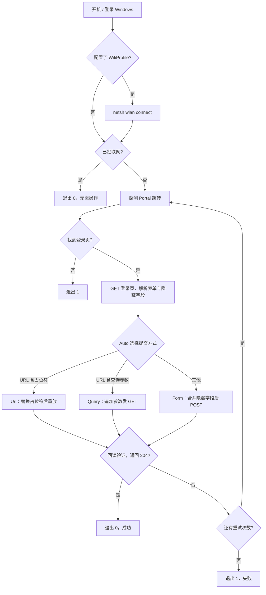

<div align="center">

# 长沙学院校园网自动连接

登录 Windows 后自动完成校园网网页 Portal 认证。

自包含 PowerShell 脚本 · 零依赖 · 密码使用 Windows DPAPI 加密存储

[](https://github.com/sixrg7734/ccsu-campus-network-login/actions/workflows/test.yml)
[](#兼容性)
[](#兼容性)
[](LICENSE)

[English](README.en.md) · 简体中文

</div>

---

## 简介

长沙学院的校园网采用网页 Portal 认证：连上 Wi-Fi 后浏览器弹出登录页，输入学号和密码，之后才能上网。每次开机都要重复一遍。

本项目把这一步自动化：填写并提交登录表单，然后回读验证网络是否真的连通，未连通时按配置重试。脚本不假设门户的结构，而是在运行时探测 Portal 跳转，并从登录页 HTML 中解析出实际使用的字段名与隐藏参数（如 `wlanuserip`、`wlanacname`、`nasip`）。因此适配另一所学校通常只需修改配置。

## 适用范围

只处理网页 Portal 认证，包括标准 Portal（华为、H3C 等）、深澜（Srun）、Dr.COM / 城市热点等常见形态。以下场景不适用：

- 客户端认证：学校要求安装深澜、Dr.COM、锐捷、天翼等客户端软件的场景。
- PPPoE 拨号。
- 带验证码（CAPTCHA）的门户。
- 在浏览器端对密码做 RSA 或自定义加密的门户。这类门户的密码由页面脚本计算，无法重放。

## 账号与隐私

脚本使用你本人的账号和密码，登录你本人的账号，不包含绕过认证、伪造身份或尝试口令的逻辑。

脚本不发送遥测，也不连接第三方服务器。除学校门户和你在配置中指定的连通性检测地址以外，不发起其他请求。

---

## 功能

| 项目 | 说明 |
|---|---|
| 零依赖 | 只使用系统自带的 PowerShell，不需要 Python、Node 或任何第三方库 |
| 自动识别门户 | 运行时探测 Portal 跳转，并从登录页 HTML 中解析真实的字段名与隐藏参数 |
| 多种提交方式 | `Query`（参数拼在 URL 上发 GET）、`Form`（解析表单后 POST）、`Url`（重放抓包得到的请求），`Auto` 自动选择 |
| 密码加密存储 | 使用 DPAPI（`CurrentUser` 作用域）加密，密文只能在同一台电脑的同一个 Windows 用户下解开 |
| 提交后回读验证 | 认证后请求连通性检测地址（默认 `generate_204`）确认是否真的联网，未通过则按配置重试并返回退出码 1 |
| 日志脱敏 | 写日志前把密码字段替换为 `***`，避免门户把密码回显到错误页时被记录下来 |
| 可选的掉线保活 | 安装自启时可附加每 10 分钟一次的检查触发器，掉线后自动重连 |
| 附带测试 | 仓库内含一个模拟 Portal 网关，端到端运行真实脚本，共 40 条断言 |

---

## 快速开始

```powershell
git clone https://github.com/sixrg7734/ccsu-campus-network-login.git
cd ccsu-campus-network-login

# 向导：探测门户 → 输入账号密码 → 试跑一次 → 安装开机自启
powershell -NoProfile -ExecutionPolicy Bypass -File .\Setup-CampusNet.ps1
```

也可以只把 `Connect-CampusNet.ps1` 和 `Setup-CampusNet.ps1` 下载到同一个文件夹，效果相同。

向导会依次询问各项设置，直接回车即采用默认值。安装完成后，每次登录 Windows 约 20 秒后自动认证。如果只想试用、不安装自启，在最后一步回答 `n`。

运行环境为 Windows 10 / 11 自带的 Windows PowerShell 5.1，PowerShell 7 同样可用。

> 向导第一步会探测门户。如果你当前已经在线，页面上不存在拦截跳转，因此拿不到字段名，向导会给出提示。想得到准确结果，请先断开 Wi-Fi 或拔掉网线，再运行一次。

### 常用命令

```powershell
.\Connect-CampusNet.ps1              # 手动认证一次（已联网则直接退出）
.\Connect-CampusNet.ps1 -Force       # 忽略当前状态，强制认证一次
.\Connect-CampusNet.ps1 -Probe       # 只探测门户，打印字段名并导出页面 HTML
.\Connect-CampusNet.ps1 -ProbeJson   # 同上，但输出 JSON（供向导调用）
.\Setup-CampusNet.ps1                # 重新运行设置向导
.\Setup-CampusNet.ps1 -Test          # 重新试跑一次，不修改配置
.\Setup-CampusNet.ps1 -Uninstall     # 取消开机自启
.\tests\Run-Tests.ps1                # 运行完整测试（40 条断言）
```

`Connect-CampusNet.ps1` 的退出码：

| 退出码 | 含义 |
|---|---|
| `0` | 认证成功，或当前已在线无需操作 |
| `1` | 认证失败 |
| `2` | 找不到配置文件，需先运行 `Setup-CampusNet.ps1` |

另有 `-Quiet`（只输出必要信息）、`-NoLog`（不写日志）和 `-ConfigPath`（指定其他配置文件）可用。

---

## 工作原理



脚本先 GET 登录页，提取页面中所有 `<input>` 的 `name`、`value` 和 `type`，再把你配置的账号与密码字段填入。`wlanuserip`、`wlanacname`、`nasip` 一类的会话参数都在运行时从页面读取，不会写死在配置里。

`Mode` 决定提交方式，`Auto` 的判定顺序是：`LoginUrl` 中含 `{占位符}` 时用 `Url`，含查询参数时用 `Query`，其余情况用 `Form`。提交后请求连通性检测地址确认结果，未通过则重试。

---

## 目录结构

```
.
├── Connect-CampusNet.ps1            主脚本（开机自启调用的就是它）
├── Setup-CampusNet.ps1              设置向导，以及自启的安装与卸载
├── campus-net.config.example.json   配置样例
├── campus-net.config.ccsu.example.json  长沙学院配置样例
├── tests/
│   ├── Mock-Portal.ps1              模拟 Portal 网关（基于 TcpListener 手写 HTTP/1.1）
│   └── Run-Tests.ps1                端到端测试，对模拟网关运行真实脚本
├── .github/workflows/test.yml       CI：语法检查 + 端到端测试
├── README.md / README.en.md
└── LICENSE
```

运行时会在脚本目录生成 `campus-net.config.json` 和 `连网日志.txt`（日志超过 512 KB 会自动轮转为 `.old`）。两者都已在 `.gitignore` 中，不会被提交。

---

## 配置说明

向导会生成大部分配置。需要手动调整时参考下表，配置文件为 `campus-net.config.json`，字段可对照 `campus-net.config.example.json`。

| 字段 | 默认值 | 说明 |
|---|---|---|
| `LoginUrl` | — | 门户登录页的完整地址。留空则每次运行时自动探测 |
| `PortalUrl` | — | 手动指定的门户地址，优先于自动探测，一般不用填 |
| `Mode` | `Auto` | `Auto` / `Url` / `Query` / `Form`。`Url` 重放抓包得到的请求（支持占位符）；`Query` 把参数拼在 URL 上发 GET；`Form` 解析页面隐藏字段后 POST；`Auto` 的判定顺序见「工作原理」 |
| `UserField` | `username` | 学号输入框的 `name` |
| `PwdField` | `password` | 密码输入框的 `name` |
| `PwdTransform` | `plain` | 提交前对密码做的变换：`plain` / `base64` / `md5` |
| `PwdTemplate` | `{pwd}` | 密码模板，可用 `{pwd}` `{plain}` `{b64}` `{b64d}`（两次 base64）`{md5}` `{user}` `{token}` |
| `TokenRegex` | — | 从登录页 HTML 中提取 token 的正则，捕获组 1 即 token，供 `{token}` 使用 |
| `ExtraFields` | — | 额外的固定参数，如 `{"wlanacname":"xxx","nasip":"1.2.3.4"}`。值中可用 `{localip}`（本机出口 IP，运行时填入）和 `{user}` |
| `Headers` | — | 额外的请求头，如 `{"Referer":"http://..."}` |
| `User` | — | 账号 |
| `UserSuffix` | — | 拼接在账号后面的后缀。Dr.COM / 城市热点用它区分运营商，如 `@lt`（联通）、`@dx`（电信） |
| `PwdEnc` | — | DPAPI 加密后的密码，不要手动修改 |
| `PwdPlain` | — | 明文密码，留空即使用 `PwdEnc` |
| `WifiProfile` | — | 认证前要自动连接的 Wi-Fi 配置名，即「已保存的网络」中的名称 |
| `SuccessTestUrl` | `http://connect.rom.miui.com/generate_204` | 连通性检测请求的地址 |
| `SuccessStatus` | `204` | 期望的响应状态码 |
| `SuccessRegex` | — | 期望的响应正文正则。匹配到即判定为在线；未匹配时仍按状态码判断 |
| `AllowInvalidCert` | `false` | 是否接受自签名或已过期的证书。部分学校门户必须开启，代价见「安全说明」 |
| `RetryCount` | `6` | 重试次数 |
| `RetryDelaySec` | `10` | 重试间隔，单位为秒 |
| `LogFile` | `<脚本目录>\连网日志.txt` | 日志路径 |

### 重放抓包得到的请求（`Mode = Url`）

部分门户（长沙学院即是一例）的登录页完全由 JavaScript 生成，HTML 中不含 `<form>`，`-Probe` 解析不出任何字段。这种情况使用 `Url` 模式：把浏览器中抓到的真实登录请求地址整条粘贴进来，只把账号、密码和本机 IP 三个值换成占位符，脚本每次运行时替换后再发出。

```json
"Mode": "Url",
"LoginUrl": "http://10.0.100.3:801/eportal/portal/login?user_account={user}&user_password={pwd}&wlan_user_ip={localip}"
```

可用的占位符：

| 占位符 | 替换为 | 是否 URL 编码 |
|---|---|---|
| `{user}` | 账号（已拼接 `UserSuffix`） | 是 |
| `{userraw}` | 同上，不做编码 | 否 |
| `{pwd}` | 密码（已按 `PwdTransform` / `PwdTemplate` 变换） | 是 |
| `{plain}` | 明文密码 | 是 |
| `{b64}` | base64 编码后的密码 | 是 |
| `{md5}` | md5 后的密码 | 否 |
| `{localip}` | 本机出口 IP（随 DHCP 变化，因此必须用占位符） | 否 |
| `{token}` | 由 `TokenRegex` 从登录页提取的 token | 是 |

其余参数原样保留，所以你可以把抓到的 URL 整条贴进来，只改这三处。`Mode` 保留 `Auto` 也可以：只要 `LoginUrl` 中出现 `{占位符}`，`Auto` 就会选择 `Url`。

### 常见门户的配置

| 门户类型 | 典型填法 |
|---|---|
| 华为 / H3C 等标准 Portal | `Mode = Query`。跳转地址中已带 `wlanuserip` / `wlanacname` / `nasip`，只需替换账号密码字段 |
| 深澜 Srun | 多数版本需要 `PwdTransform = base64`；页面中含 token 时配置 `TokenRegex` 供 `{token}` 使用 |
| Dr.COM 老版本 | 通常要求密码以 `0` 开头，即 `PwdTemplate = 0{pwd}` |
| 纯 JS 渲染的门户（抓不到 `<form>`） | 使用 `Mode = Url` 重放抓包得到的请求，见上一节 |

### 长沙学院（CCSU）配置参考

长沙学院使用城市热点 Dr.COM，门户地址为 `http://10.0.100.3/`，认证接口在 801 端口。下表中的取值来自门户自身输出的配置变量和学校网络中心的说明：

| 项目 | 值 | 来源 |
|---|---|---|
| 无线信号 | 教师 `CCSU-Teacher` / 学生 `CCSU-Student` | [网络中心《校园网上网操作指南》](http://nic.ccsu.cn/info/1441/9601.htm) |
| 门户地址 | `http://10.0.100.3/` | 同上 |
| 认证接口 | `http://10.0.100.3:801/eportal/?c=ACSetting&a=Login` | 门户页内 `authloginpath` |
| 账号字段名 | `DDDDD` | 门户页内 `authuserfield` |
| 密码字段名 | `upass` | 门户页内 `authpassfield` |
| 页面编码 | `gb2312` | 门户页内 `charset` |
| 登录成功标志 | `Dr.COMWebLoginID_3.htm` | 门户页内 `authsuccess` |

“选择运营商”不是下拉框，而是一组单选按钮，其作用是在账号后面拼接后缀。门户中该段配置原文为：

```js
carrier='{"yys":{"title":"服务类型","mode":"radiobutton","type":"0","data":[
  {"id":"1","name":"校园用户","suffix":""},
  {"id":"2","name":"校园电信","suffix":"@dx"},
  {"id":"3","name":"校园联通","suffix":"@lt"},
  {"id":"4","name":"校园其他","suffix":""}],"defaultID":"1"}}';
```

对应关系如下：

| 选择的运营商 | 实际提交的账号 | 配置写法 |
|---|---|---|
| 校园用户 | `2023000000` | `"UserSuffix": ""` |
| 校园电信 | `2023000000@dx` | `"UserSuffix": "@dx"` |
| 校园联通 | `2023000000@lt` | `"UserSuffix": "@lt"` |

脚本自 v1.1 起原生支持这一机制：`UserSuffix` 会拼接在账号之后，单选按钮组提交被 `checked` 的那一项。v1.0 会错误地提交该组最后一项，这个问题正是适配此门户时发现并修复的。

可直接复制的配置见 [`campus-net.config.ccsu.example.json`](campus-net.config.ccsu.example.json)，复制为 `campus-net.config.json` 即可使用。

#### 抓取一次真实登录请求

该门户的登录页完全由 JavaScript 渲染，HTML 中没有 `<form>`，`-Probe` 解析不出字段，只有真实登录请求才能确定完整的参数集合。抓取过程约两分钟：

1. 在浏览器中按 `F12`，切到 Network 面板，勾选 Preserve log；
2. 退出校园网登录，或从未登录状态开始，手动登录一次；
3. 在 Network 中找到那条登录请求，路径通常含 `eportal`；
4. 右键选择 Copy as cURL，或直接查看它的 Query String / Form Data。

然后按请求形态填写配置：

- 请求是 GET（参数在网址上）：使用 `Mode = Url`，把网址整条贴进 `LoginUrl`，只把账号、密码、本机 IP 分别换成 `{user}` / `{pwd}` / `{localip}`：

  ```json
  "Mode": "Url",
  "LoginUrl": "http://10.0.100.3:801/此处粘贴抓到的完整网址，账号换成 {user}，密码换成 {pwd}，IP 换成 {localip}"
  ```

- 请求是 POST（参数在表单中）：使用 `Mode = Form`，`LoginUrl` 填请求目标地址，其余表单参数填入 `ExtraFields`（`wlanuserip` 用 `{localip}`）。

`campus-net.config.ccsu.example.json` 中已按 GET 形态写好一个起点，你只需把 `LoginUrl` 换成自己抓到的那一条。

> 字段名和运营商机制已确认，完整参数集合尚未确认：本机处于已认证状态，抓不到未登录状态的登录页。示例配置是根据门户自身的配置变量及其 JavaScript 推断出的起点，尚未验证可用。

---

## 故障排查

### 提示探测不到门户

按可能性排序：

- 当前已经在线，此时不存在拦截跳转，探测不到属于正常结果；
- Wi-Fi 未连接，请在配置中填写 `WifiProfile`；
- 学校使用客户端软件而非网页认证，本项目不适用。

### 探测到门户，但认证后仍不通

- 检查 `UserField` / `PwdField` 是否填写正确。可查看 `.\Connect-CampusNet.ps1 -Probe` 打印的字段列表，或导出的完整 HTML（见 `门户探测结果.txt`）；
- 密码需要变换时，尝试 `PwdTransform` 的 `base64` 或 `md5`；
- 页面要求 token 或额外参数时，配置 `TokenRegex` 或 `ExtraFields`；
- 最有效的办法是抓一次真实登录请求进行对照：浏览器按 `F12`，切到 Network，手动登录一次，右键该请求选择 Copy as cURL，或直接查看 URL 与 Form Data，把参数名抄进配置。

### 提示密码解密失败

DPAPI 密文绑定当前电脑和当前 Windows 用户。更换电脑、更换账户、重装系统，或把配置文件复制到别处，都会导致解密失败。重新运行 `.\Setup-CampusNet.ps1` 输入一次密码即可。

如果确实需要跨机器使用，可以把明文填入 `PwdPlain`，但这样密码就是明文存储的。

### 证书错误，或认证请求直接失败

学校门户常使用自签名或已过期的证书。可在配置中把 `AllowInvalidCert` 设为 `true`，或重新运行向导时回答 `y`。

开启后脚本不再校验证书，理论上更容易受到中间人攻击。只应在门户确实使用问题证书时开启，并且不要长期在公共 Wi-Fi 上保持开启。

### 手动运行一次计划任务

```powershell
Start-ScheduledTask -TaskName 'CampusNet-Autoconnect'
Get-ScheduledTaskInfo -TaskName 'CampusNet-Autoconnect' | Select LastRunTime, LastTaskResult
```

---

## 测试

本项目不以「脚本没有报错」作为成功的依据。仓库内含一个模拟校园网网关（`tests/Mock-Portal.ps1`），其行为与真实门户一致：未认证时返回 `302` 跳转到登录页，认证后返回 `204`。

`tests/Run-Tests.ps1` 会启动该网关，运行真实主脚本，再从门户一侧核对实际收到的请求：

```powershell
.\tests\Run-Tests.ps1
```

当前结果：Windows PowerShell 5.1 下 40/40 通过。

| 场景 | 断言内容 |
|---|---|
| A `Form` 模式 | 退出码 0 · 门户收到 `POST /login` · 门户判定登录成功 · 页面中的隐藏字段被一并提交 |
| B `Query` 模式 | 退出码 0 · 门户收到带 `username` 的 GET · 原有查询参数未被丢弃 · 登录成功 |
| C 密码错误 | 退出码 1 · 门户记录到 `LOGIN-FAIL` |
| D DPAPI 密文 | 退出码 0 · 解出的密码与原文一致 |
| E `-ProbeJson` 契约 | stdout 是合法 JSON · 在线状态正确 · 门户地址识别正确 · 账号与密码字段推测正确 · 表单 action 正确解析 · 字段枚举完整 |
| F Dr.COM / 城市热点形态 | 账号带 `@lt` 后缀正确提交 · 密码发送到 `upass` · 单选按钮提交被 `checked` 的那一项（既不是第一项也不是最后一项） · `{localip}` 展开为真实 IP · 静态 `ExtraFields` 透传 · 门户接受登录 |
| G Dr.COM 页面的 `-ProbeJson` | 账号字段推测为 `DDDDD` · 密码字段推测为 `upass` · 运营商字段推测为 `yys` · 单选组枚举出 3 个选项 · `<select>` 被解析并取 `selected` 项 |
| H `Mode = Url` 重放 | 退出码 0 · `{user}` 替换为带 `@lt` 后缀的账号并正确 URL 编码 · `{pwd}` 替换成功 · `{localip}` 替换为真实 IP · 字面参数原样保留 · 门户接受重放 |

场景 F 和 G 的模拟页面中被 `checked` 的单选按钮值为 `2`，而选项顺序是 `1 / 2 / 3`，因此“取第一项”和“取最后一项”两种写法都会失败。v1.0 属于后者，会把联通用户登录成校园用户。

场景 E 验证的是 `Setup-CampusNet.ps1` 与 `Connect-CampusNet.ps1` 之间的接口，向导依靠它获取探测结果。

测试完全在本地进行，所有 URL 都指向 `127.0.0.1`，不联网，可以直接在 CI 中运行。`.github/workflows/test.yml` 已配置好，推送后自动执行语法检查与端到端测试，并在 PowerShell 7 下再跑一遍。

---

## 安全说明

- 密码使用 Windows DPAPI（`CurrentUser` 作用域）加密，密文只能在当前用户于当前这台电脑上解开，配置文件被复制到别处也无法解密。代价是更换机器、更换用户或重装系统后必须重新运行向导。
- 开机自启采用「登录时触发」而非「开机时触发」。开机阶段用户配置单元尚未加载，DPAPI 无法解密。向导安装的是 `AtLogOn` 触发器，并附加 20 秒延迟。
- 脚本不写注册表，也不修改系统设置，只读写自己所在的目录。
- 密码在写入日志前会被替换为 `***`。
- `campus-net.config.json`、`连网日志.txt` 和 `门户探测结果.txt` 均已在 `.gitignore` 中。提交前请确认 `git status` 中没有它们。`门户探测结果.txt` 包含完整的门户页面，可能带有你的 IP 和 MAC 地址。
- 未提权运行时，自启会退化为启动文件夹中的快捷方式（`.lnk`，UTF-16 编码，中文路径不受影响）。功能正常，只是没有掉线保活触发器，需要保活时请以管理员身份重新运行向导。

---

## 已知限制

- 只支持网页 Portal 认证，不支持客户端认证（深澜、Dr.COM、锐捷、天翼等客户端模式）和 PPPoE 拨号。
- 不支持带验证码（CAPTCHA）的门户。
- 不支持在浏览器端对密码做 RSA 或自定义加密的门户。这类门户的密码由页面 JavaScript 计算，脚本无法重放。变通办法是用 `F12` 抓一次真实登录的完整 URL，填入 `LoginUrl`，并把 `Mode` 设为 `Url`。
- 仅支持 Windows，依赖 DPAPI 和任务计划程序。
- 脚本提交表单时必须持有明文密码，这是 HTTP 表单认证本身决定的。DPAPI 保护的是静态存储，不是运行时内存。

---

## 兼容性

| 项目 | 说明 |
|---|---|
| 系统 | Windows 10 / 11（Windows Server 2016 及以上应该可用，未实测） |
| PowerShell | Windows PowerShell 5.1（主要目标）、PowerShell 7（CI 中会运行一遍） |
| 权限 | 普通用户即可运行。安装带保活触发器的计划任务需要管理员权限 |

---

## 贡献

欢迎提交 PR。提交前请：

1. 运行 `.\tests\Run-Tests.ps1`，确认 40/40 通过；
2. 如果修改了 `Connect-CampusNet.ps1`，请在 `Run-Tests.ps1` 中补充对应的断言，不要只靠肉眼确认；
3. 确认 `.ps1` 文件保存为 **UTF-8 带 BOM**，其余文件不带 BOM。

第 3 条的原因：Windows PowerShell 5.1 会把无 BOM 的 UTF-8 按系统 ANSI 代码页解析，中文注释会变成乱码并导致语法错误。反过来，给 `.md` / `.json` / `.yml` 加上 BOM 也有害，带 BOM 的 YAML 会让 GitHub Actions 解析失败。CI 中有语法检查兜底。

如果你成功适配了某所学校的门户，欢迎把配置片段（去掉账号和密码）提 PR 或开 issue，方便同校的同学直接使用。

---

## 许可

[MIT](LICENSE)。

## 免责声明

本项目仅供个人在自己的账号上自动化登录使用。请遵守你所在学校的网络使用规定。使用者需自行承担因使用本工具产生的一切后果，作者不对任何滥用或由此造成的损失负责。
